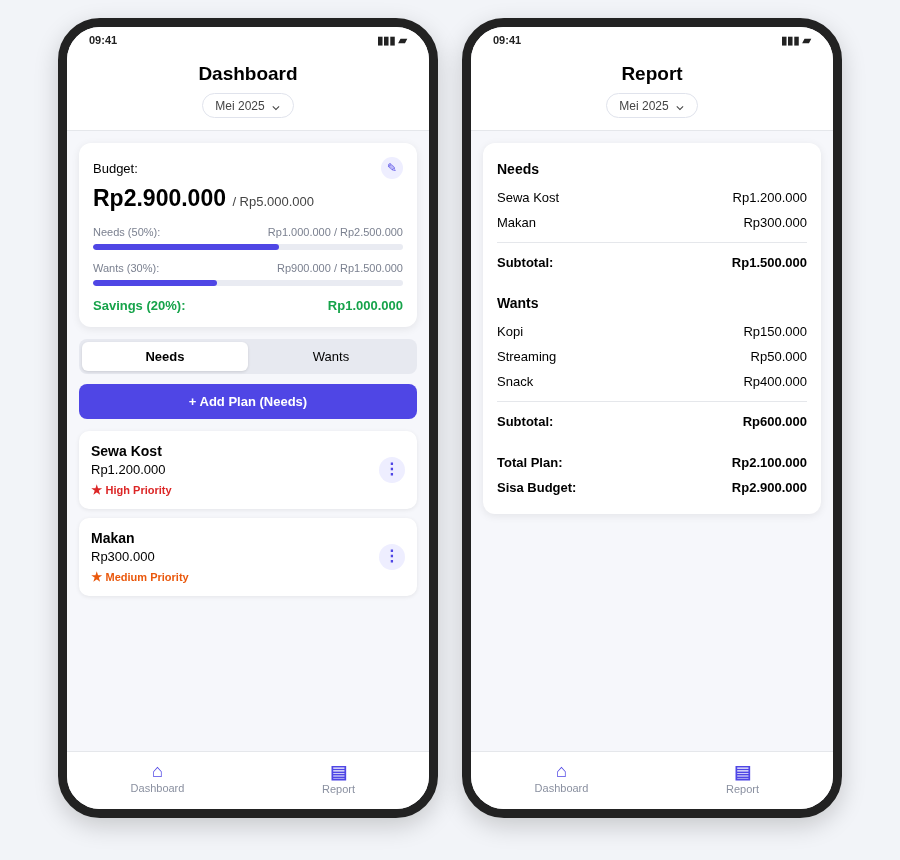

# BudgeThink

Aplikasi iOS untuk merencanakan dan memantau anggaran bulanan. Dibangun sebagai
proyek tim saat **Apple Foundation Program @ UC** (28 April – 23 Mei 2025).

## Fitur

- **Dashboard**
  - Atur total budget bulanan
  - Alokasi otomatis **Needs 50% / Wants 30% / Savings 20%**
  - Progress bar sisa anggaran Needs & Wants
  - Tambah, edit, dan hapus rencana pengeluaran (plan)
  - Prioritas (*High / Medium / Low*) dengan penanda warna
  - Filter kategori **Needs** dan **Wants**
  - Pilih bulan & tahun melalui date picker
- **Report**
  - Rincian rencana per kategori
  - Subtotal Needs, subtotal Wants, total plan, dan sisa budget

## Teknologi

- Swift 5
- SwiftUI
- SwiftData (`@Model`, `@Query`, `modelContainer`)
- Xcode project (tanpa dependency eksternal)

## Tampilan



*Preview di atas direkonstruksi dari struktur kode SwiftUI (komponen, label, dan
data contoh). Bukan screenshot simulator asli — environment yang dipakai untuk
menyiapkan repository ini tidak memiliki Xcode/iOS Simulator.*

## Kontribusi

Bagian yang dikerjakan oleh **Yanesa Ringga Noval Andrianto**:

- UI Dashboard & Report (SwiftUI)
- Model data `Plan`, `Budget`, enum kategori dan prioritas (SwiftData)
- Logika alokasi Needs/Wants/Savings dan perhitungan subtotal
- Testing/build serta koordinasi integrasi perubahan tim
- Presentasi prototipe ke kelompok

Karena sebagian anggota tim tidak memiliki akun GitHub, koordinasi perubahan
dan integrasi pada masa pengembangan dilakukan melalui WhatsApp.

## Menjalankan proyek

1. Buka `BudgeThink.xcodeproj` dengan **Xcode 15+**
2. Pilih iOS Simulator (iOS 17+ karena memakai SwiftData)
3. Tekan `Cmd + R` untuk build & run

Tidak ada langkah instalasi dependency.

## Struktur

```
BudgeThink/
├── ContentView.swift      Dashboard, model Plan/Budget, form plan
├── ReportView.swift       Laporan Needs/Wants & perhitungan
├── MainView.swift         TabView Dashboard/Report
├── AppState.swift         State bulan & tahun terpilih
├── BudgeThinkApp.swift    Entry point + modelContainer
└── Assets.xcassets        App icon & accent color
BudgeThinkTests/           Unit test
BudgeThinkUITests/         UI test
```

## Lisensi

Tidak ada file lisensi di repository asli. Gunakan kode ini dengan izin pemilik
proyek.
